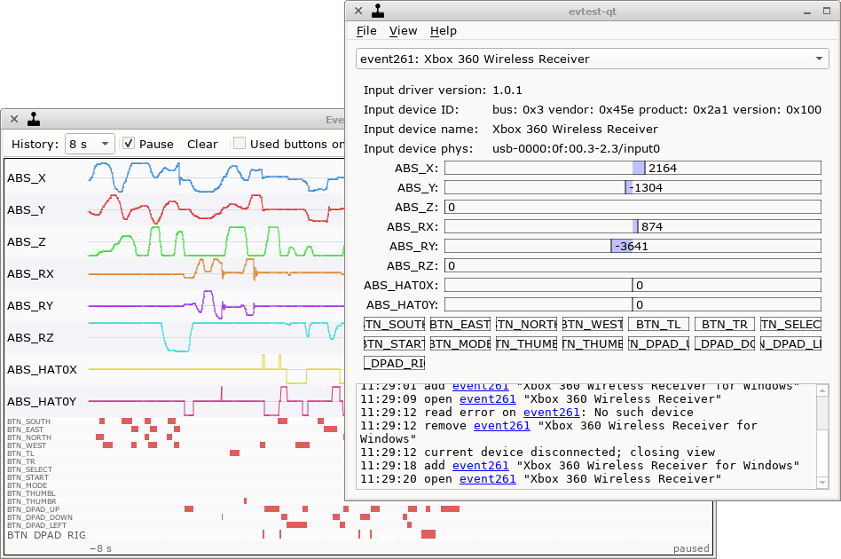

<!--
SPDX-FileCopyrightText: 2015-2026 Ingo Ruhnke <grumbel@gmail.com>
SPDX-License-Identifier: GPL-3.0-or-later
-->

[](https://travis-ci.org/Grumbel/evtest-qt)

evtest-qt
=========

`evtest-qt` is a graphical input device tester for Linux, analogous to
the `evtest` command-line tool. It lists attached evdev devices and
shows absolute axes, relative axes, buttons, and multitouch state in
real time.

 * https://github.com/Grumbel/evtest-qt/


Features
--------

- Device list for `/dev/input/event*`
- udev hotplug (add/remove with log)
- Absolute and relative axis widgets
- Button/key grid with press/release/repeat feedback
- Multitouch pad when `ABS_MT_SLOT` is present
- Verification mode (highlight controls that have been used)
- Event log with clickable device links
- Event Graph window (time-series plot of axes and buttons)
- CLI device selection (`/dev/input/eventN` or `eventN`)
- Qt6 (preferred) or Qt5


Dependencies
------------

- **Qt6** or **Qt5** (Core, Widgets)
- **libudev**
- **libevdev**
- **CMake** ≥ 3.7, **C++23**, **pkg-config**


Compiling
---------

```bash
mkdir build && cd build
cmake ..
make
```

Extra warnings: `cmake .. -DWARNINGS=ON`


Usage
-----

Reading `/dev/input/event*` needs permission. Most distributions grant
that via the `input` group (`usermod -aG input $USER`, then re-login).
Otherwise run as root:

```bash
sudo ./build/evtest-qt
sudo ./build/evtest-qt /dev/input/event1
```

Options: `-h` / `--help`, `-v` / `--version`, `--verification-mode`.


Nix
---

```bash
nix run github:Grumbel/evtest-qt
```

From a local checkout: `nix run` (pass args after `--`).


Screenshots
-----------




Licence
-------

GPLv3+. See [LICENSE.txt](LICENSE.txt).
